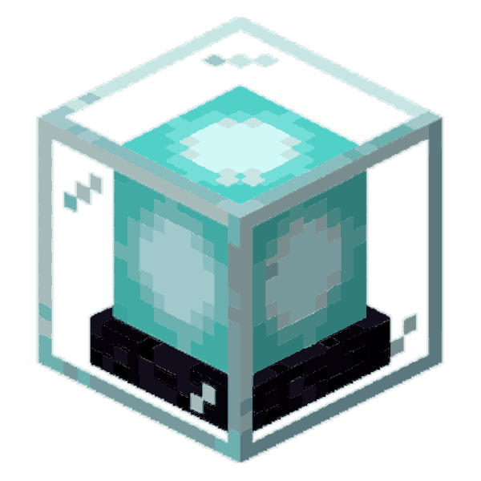
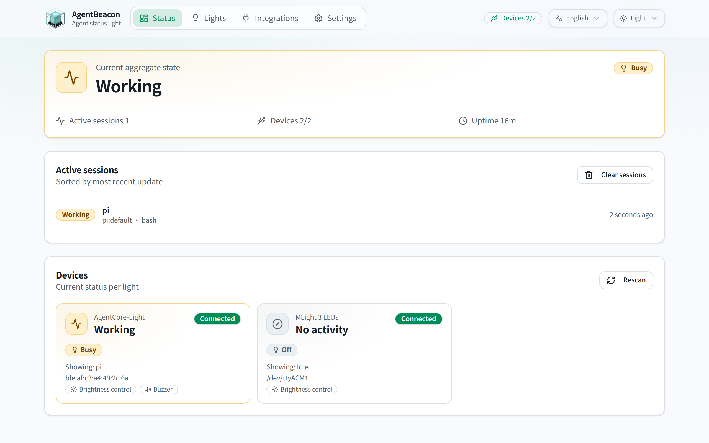
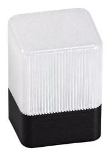
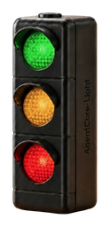
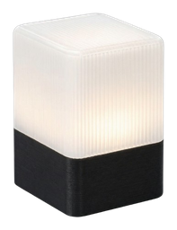

<p align="center">
  
</p>

<h1 align="center">AgentBeacon</h1>

<p align="center">
  Sync coding-agent status to a USB status light.
</p>

<p align="center">
  <a href="https://github.com/zeaphoo/AgentBeacon/actions/workflows/ci.yml"></a>
  <a href="https://github.com/zeaphoo/AgentBeacon/actions/workflows/release.yml"></a>
  <a href="LICENSE"></a>
  <a href="README.zh-CN.md">中文</a>
</p>



## Overview

AgentBeacon turns coding-agent status into a light on your desk.

- **What it does** — aggregates `idle` / `working` / `waiting` / `error` from Pi, Claude Code, Codex CLI, Gemini CLI and more, then drives the light.
- **Cross-platform** — one Rust service, React console, and Tauri desktop app for Linux, macOS, and Windows.
- **Many devices** — MLight, YH50-RGY-J, AgentCore-Light, PromLight over USB CDC, serial, Bluetooth SPP, and BLE.

Runs fully local on `127.0.0.1:6980` — no account, no telemetry.

## Features

- **Real-time agent status** — aggregate `idle`, `working`, `waiting`, and `error` sessions into one semantic state.
- **USB status lights** — MLight single/3-LED and YH50-RGY-J support, with hot-plug discovery and per-device profiles.
- **Device capabilities** — brightness and buzzer features are shown per device and per supported model.
- **Web console** — status overview, manual light control, automatic settings save, device bindings, and supported-device reference.
- **Desktop app** — splash screen, tray controls, launch at login, and supervised local service for Linux, macOS, and Windows.
- **Agent integrations** — installer-managed hooks and plugins for Pi, OpenCode, DeepSeek Harness, Claude Code, Codex CLI, Qoder CLI, the Gemini CLI family (Gemini / Qwen Code / iFlow), Google Antigravity, Grok Build, and more; any agent via CLI or HTTP.
- **Hook diagnostics** — a bounded journal of hook events and state transitions, readable through `agent-beacon hooks` or `GET /api/v1/hooks`.
- **Bilingual and themeable UI** — Chinese/English, light/dark themes, system-language initialization, and system-following theme mode.
- **Local by default** — the service listens on `127.0.0.1:6980`; no cloud account or telemetry is required.

## How it works



Agents (Claude Code, Codex CLI, Pi, …) report session state to the local service. The service
aggregates one global state and fans agents / sessions out to the lights with a multi-light strategy:
unified, auto by Agent, manual by Agent, or auto by Session (sessions of one Agent spread across
lights). Each light then renders the state it was actually assigned. New sessions are only handed to lights
that are currently connected; a light that drops keeps its existing assignments for a 15-second grace
window and picks them up again when it reconnects, after which they move to the lights that are online.
Strategy, assignments and effect mapping are all editable per device in the console.

The animation is vector SVG (SMIL), so it stays sharp at any zoom and weighs ~150 KB; regenerate it with
`python3 scripts/how-it-works-svg.py --lang en` after changing devices or strategies.

## Supported devices

| Photo | Profile | Connection | Brightness | Buzzer | Pick | Buy | Notes |
| --- | --- | --- | :---: | :---: | :---: | --- | --- |
| — | `mlight-single` | USB CDC | ✅ | — | — | — | Single-LED RGB status light (technical profile only, no separate listing) |
|  | `mlight-3led` | USB CDC | ✅ | — | ✅ | [Taobao](https://item.taobao.com/item.htm?id=1086328824173&skuId=6321112478105) | Three-LED RGB status light |
| — | `yh50-rgy-j` | USB serial / libusb | — | ✅ | — | — | Tri-color LED with buzzer |
|  | `agentcore-light` | USB CDC / Bluetooth SPP / BLE (NUS) | ✅ | ✅ | — | [Taobao](https://item.taobao.com/item.htm?id=1059050729014&skuId=6102524545314) | Text-line status light; auto-detected by VID `4C4A:4155`, Espressif `303A` + product name, Bluetooth SPP port + `HELLO` handshake, or a BLE advertisement with the NUS service |
|  | `agentcore-halo` | USB CDC / Bluetooth SPP / BLE (NUS) | ✅ | ✅ | ✅ | [Taobao](https://item.taobao.com/item.htm?id=1095793862793&skuId=6317726979193) | Halo desk light speaking the same text-line protocol; recognised from the `AgentCore-Halo` / `AgentCore-Halo-BLE` name, and shows its device name, firmware and battery (Light reports battery too) |

The **Pick** column is the maintainers' recommendation: `mlight-3led` (three LEDs, clearest status) and `agentcore-halo` (USB + Bluetooth, battery telemetry). More purchase links and photos: [Hardware purchase links](docs/hardware-purchase.md).

The web console displays the supported capabilities as feature badges on each connected device. AgentCore devices also show their self-reported name (`AgentCore-Halo-BLE`, …), firmware version and, for `agentcore-light` / `agentcore-halo`, the battery telemetry from the device's `CHG:` reports. Protocol differences between the two AgentCore models are documented in [`docs/AgentCore-Halo-serial-protocol.md`](docs/AgentCore-Halo-serial-protocol.md).

### AgentCore-Light over USB and Bluetooth

AgentCore-Light speaks a text-line protocol (`HELLO` / `STATUS` / `IDLE` / `BUSY` / …) over USB CDC or Bluetooth SPP. Detection is automatic:

- **USB CDC** — recognised by `4C4A:4155`; the early Espressif firmware (`303A`) must also expose `agentcore` / `jieli` / `ac696` in the product name or serial, so other ESP32 boards are ignored.
- **Bluetooth SPP** — any Bluetooth serial port (`SerialPortType::BluetoothPort`, or a port name containing `bluetooth` / `jl_spp` / `rfcomm` / `标准串行`) is probed once with `HELLO`; only a device answering `HELLO:OK` becomes a light. On Windows, where COM ports carry no USB metadata, bind it explicitly:

  ```json
  { "devices": [{ "port": "COM5", "profile": "agentcore-light" }] }
  ```

  Pair the device once (`bluetoothctl pair <MAC>`), then either let the worker find its Bluetooth serial port or bind the RFCOMM address directly — `spp:AA:BB:CC:DD:EE:FF` — which needs neither root nor a `/dev/rfcomm*` node:

  ```json
  { "devices": [{ "port": "spp:AF:C3:A4:E1:D8:95", "profile": "agentcore-light" }] }
  ```
- **BLE (NUS)** — connected over the Nordic UART Service and driven with the same text protocol (MTU-chunked writes, de-duplicated notifications).

Discovery tries the transports in order of reliability: USB CDC (while plugged in) → devices **BlueZ already knows** (pairing is enough; no advertising, no scan) → SPP over RFCOMM → advertising scan as a last resort. That matters because the light stops advertising as soon as something is connected to it, so scanning alone can never find an already-connected device. Background scanning also pauses while a BLE light is connected, because BlueZ's discovery tears down LE links. Diagnostics: `cargo run -p agent-beacon-lights --example bt_links` (known devices, no scan), `--example spp_probe -- AA:BB:CC:DD:EE:FF`, `--example ble_scan`, `--example ble_status -- name:AgentCore-Light-BLE`, and `--example agentcore_watch -- ble:AA:BB:CC:DD:EE:FF 20` to dump raw reports. Details in the [protocol document](docs/AgentCore-Light-serial-protocol.md).

## UI

The main window has four sections:

- **Status** — current aggregate state, active sessions, connected devices, and live service uptime.
- **Lights** — manually override the automatic light effect (effect, duration, target device), list devices with per-device profile bindings, and open the supported models list in a scrollable dialog. The last duration you used is remembered for next time.
- **Settings** — state-to-effect mapping, light behavior (brightness, turn-off on shutdown, alert buzzer), device image visibility, and service information.
- **Integrations** — every detected agent with its install state, one-click install/upgrade/uninstall, and an *install automatically* switch.

Language and theme selectors are available directly in the navbar. The status card uses the current state color as a subtle surface, with a larger icon and label for quick recognition.

## Quick start

1. Download the latest package from [Releases](https://github.com/zeaphoo/AgentBeacon/releases):
   - Linux: `.deb` or `.AppImage`
   - macOS: arm64 or x86_64 `.dmg`
   - Windows: NSIS installer, MSI, or portable `.zip`
2. Launch **AgentBeacon** (or run `agent-beacon` and open `http://127.0.0.1:6980`).
3. Plug in an MLight or YH50-RGY-J status light. The device is discovered automatically.
4. Install an agent integration:

   ```bash
   agent-beacon integrate install pi           # Pi
   agent-beacon integrate install opencode     # OpenCode
   agent-beacon integrate install dsh          # DeepSeek Harness
   agent-beacon integrate install claude-code  # Claude Code
   agent-beacon integrate install codex        # Codex CLI
   agent-beacon integrate install gemini       # Gemini CLI (also qwen, iflow)
   agent-beacon integrate install antigravity  # Google Antigravity
   agent-beacon integrate install grok         # Grok Build
   agent-beacon integrate install qoder        # Qoder CLI
   agent-beacon integrate install codebuddy    # CodeBuddy (also workbuddy)
   agent-beacon integrate install github-copilot  # GitHub Copilot
   agent-beacon integrate install hermes       # Hermes Agent
   agent-beacon integrate install zcode        # ZCode
   ```

   `agent-beacon integrate install` with no target installs every detected agent; `agent-beacon integrate list` shows installed, bundled, and available states.

   You can also do this from the console: the **Integrations** page lists every detected agent with its install state, one-click install/upgrade/uninstall, and an *install automatically* switch. On first launch the console offers to connect the agents it detected.

5. Open the console to inspect status, try manual lighting, or adjust settings.

For building from source, packaging, testing, and architecture details, see the [development guide](docs/development.md).

## Agent integrations

| Agent | Integration | Guide |
| --- | --- | --- |
| Pi | Extension | [Pi](docs/integrations/pi.md) |
| OpenCode | Plugin | [OpenCode](docs/integrations/opencode.md) |
| DeepSeek Harness | Cordis plugin | [DeepSeek Harness](docs/integrations/dsh.md) |
| Claude Code | `settings.json` hooks | [Claude Code](docs/integrations/claude-code.md) |
| Qoder CLI | `settings.json` hooks | [Qoder CLI](docs/integrations/qoder.md) |
| Gemini CLI · Qwen Code · iFlow | `settings.json` hooks | [Gemini family](docs/integrations/gemini.md) |
| Google Antigravity | `hooks.json` lifecycle hooks | [Antigravity](docs/integrations/antigravity.md) |
| Grok Build | `~/.grok/hooks` lifecycle hooks | [Grok Build](docs/integrations/grok.md) |
| CodeBuddy | `settings.json` hooks (Claude-style) | [CodeBuddy](docs/integrations/codebuddy.md) |
| WorkBuddy | `settings.json` hooks (CodeBuddy runtime) | [WorkBuddy](docs/integrations/workbuddy.md) |
| GitHub Copilot | `settings.json` hooks (camelCase events) | [GitHub Copilot](docs/integrations/github-copilot.md) |
| ZCode | `config.json` process hooks | [ZCode](docs/integrations/zcode.md) |
| Hermes Agent | Plugin directory (`plugin.yaml` + python) | [Hermes Agent](docs/integrations/hermes.md) |
| Codex CLI | `config.toml` `notify` | [Codex CLI](docs/integrations/codex.md) |
| Other agents | `agent-beacon report` or `POST /api/v1/events` | [HTTP API in development guide](docs/development.md#http-api) |

The built-in integrations are shipped with the service and can be installed or upgraded from the CLI.

## Documentation

- [Development guide](docs/development.md) — architecture, prerequisites, build, test, release, contributing
- [中文文档](README.zh-CN.md)
- [Changelog](CHANGELOG.md) · [中文更新日志](CHANGELOG.zh-CN.md)
- [MLight protocol](docs/MLight-serial-protocol.md)
- [YH50-RGY-J protocol](docs/YH50-RGY-J-serial-protocol.md)
- [AgentCore-Light protocol](docs/AgentCore-Light-serial-protocol.md)
- [PromLight protocol (BLE HID)](docs/PromLight-ble-hid-protocol.md)
- [AgentPulse protocol (USB CDC / BLE)](docs/AgentPulse-serial-protocol.md)
- [Hardware purchase links](docs/hardware-purchase.md)

## Project status

This is a pre-release (`0.2.0-rc.7`). APIs, configuration fields, and packaging details may change before a stable release.

## License

Licensed under the [Apache License 2.0](LICENSE).
