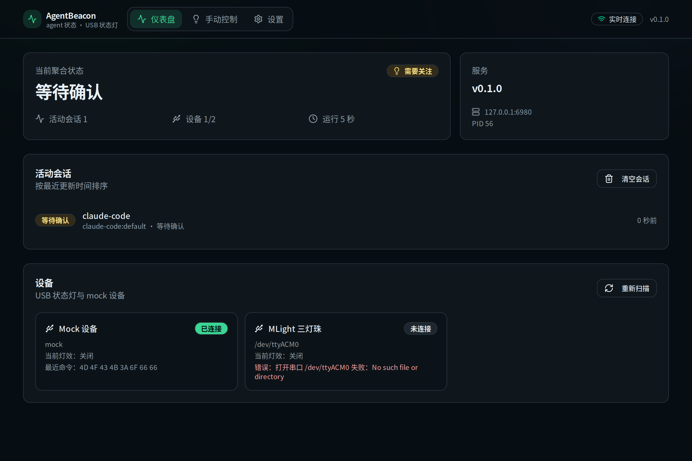

# AgentBeacon

把各类编码 agent（Claude Code、Codex 等）的状态同步到 USB 状态灯。包含一个 Rust 常驻服务、一个 React Web 控制台，以及一个管理服务的 Tauri 桌面应用。



```
agent hooks / CLI ──HTTP──▶ agent-beacon (Rust)
                              ├─ 会话聚合 → 语义灯效
                              ├─ MLight / YH50 / mock 设备 actor
                              ├─ HTTP API + SSE
                              └─ 内嵌 Web 控制台 (6980)
浏览器 / AgentBeaconApp (Tauri) ──HTTP/SSE──▶ 同一个服务
```

## 目录

```
crates/
  agent-beacon-core/     # 会话、聚合、灯效与配置模型（纯逻辑）
  agent-beacon-lights/   # 设备发现、MLight/YH50 协议、mock、设备 actor
  agent-beacon/          # axum API、SSE、静态资源、CLI → bin agent-beacon
web/                     # React + Vite + Tailwind + shadcn/ui + Zustand
desktop/src-tauri/       # Tauri 桌面壳 → bin AgentBeaconApp
scripts/                 # 三平台打包脚本
docs/                    # 接入示例与硬件验收清单
```

## 前置依赖

- Rust 1.85+、Node.js 22+、pnpm
- Linux：`webkit2gtk-4.1`、`libudev-dev`、`libusb-1.0-0-dev`、GTK3；串口用户需在 `dialout` 组
- macOS：Xcode Command Line Tools；无需安装 CH340 驱动（macOS 10.14+ 自带）
- Windows：WebView2、WCH CH340 驱动（部分系统需手动安装）

## 快速开始

```bash
# 1. 安装前端依赖并构建（服务会把产物编译期内嵌）
pnpm --dir web install
pnpm build:web

# 2. 启动服务（默认 127.0.0.1:6980）
cargo run -p agent-beacon

# 3. 打开控制台
#    http://127.0.0.1:6980/
```

开发模式（Vite HMR，端口 6973，`/api` 代理到 6980）：

```bash
pnpm dev:serve      # 终端 1
pnpm dev:web        # 终端 2 → http://127.0.0.1:6973
```

没有硬件时，可把配置里的 `mock.enabled` 设为 `true` 来启用 mock 设备。

## CLI

```bash
agent-beacon report --agent claude-code --state working
agent-beacon report --agent claude-code --state waiting --message "等待确认"
agent-beacon status
agent-beacon devices
agent-beacon serve --port 6980 --supervised

# agent 集成插件（内置在二进制中）
agent-beacon integrate list
agent-beacon integrate install            # 安装全部（pi、opencode、dsh）
agent-beacon integrate install pi
agent-beacon integrate upgrade
agent-beacon integrate uninstall pi
```

`report` 成功退出码 0；服务不可达时在 1 秒内返回非 0。`--url` 可指定其他地址。

## 状态模型

- 事件状态：`idle`、`working`、`waiting`、`error`
- 会话键：`(agent, session)`，省略 `session` 时为 `{agent}:default`
- 默认 TTL：900 秒；事件可用 `ttl_secs`（30–86400）覆盖
- 聚合优先级：`error > waiting > working > idle`；无会话为 `none`
- 默认映射：`none→off`、`idle→calm`、`working→busy`、`waiting→attention`、`error→alert`

## 配置

配置文件由服务独占写入：

- Linux：`~/.config/agent-beacon/config.json`
- macOS：`~/Library/Application Support/agent-beacon/config.json`
- Windows：`%APPDATA%\agent-beacon\config.json`

支持通过 `PUT /api/v1/config` 或 Web 设置页修改。字段见 `crates/agent-beacon-core/src/config.rs`。

## 硬件

| 设备 | 传输 | 说明 |
| --- | --- | --- |
| MLight | USB CDC 115200 8N1，ASCII 行 | 切换前 `OFF` + 350ms；组合命令间隔 300ms；单灯珠 80ms 预置 |
| YH50-RGY-J | 9600 8N1，5 字节帧 | Linux/macOS 优先 libusb Bulk，失败回退串口；Windows 仅串口 |

macOS 10.14+ 使用系统自带 `AppleUSBCHCOM`，**不要**安装 WCH 旧 kext。Windows 通常需要 WCH `CH341SER`（联网时也可能由 Windows Update 安装）。

## 桌面应用

```bash
pnpm tauri:dev
# 或打包
pnpm package:linux
pnpm package:mac      # 仅在 macOS 上
pnpm package:win      # 仅在 Windows Git Bash 上
```

桌面壳会：

- 先探测配置端口上的健康实例，存在则附着；否则以 `--supervised --port <port>` 拉起随包服务
- 通过 stdout 的 `agent-beacon: listening addr=...` 获取实际地址后再打开窗口
- 用内置 splash 展示启动中／失败状态；`--hidden` 自启动时只驻留托盘
- 关闭窗口隐藏到托盘；只在退出时停止自己拉起的服务
- 托盘提供「开机自启动」勾选项（持久化到 `desktop-prefs.json`）

## 发布

推送 `v*` 标签会触发 Release 工作流，构建并上传所有平台产物到 GitHub Release：

```bash
git tag v0.1.0-rc.1
git push origin v0.1.0-rc.1
```

产物包括 Linux `deb`/`AppImage`、macOS arm64/x86_64 `dmg`、Windows `NSIS`/`MSI` 与便携 `zip`。
也可以在 Actions 中手动触发 Release 工作流：只构建并上传 artifacts，不创建 Release，便于先验证各平台打包。

## 测试

```bash
cargo test --workspace
pnpm --dir web test
```

无硬件时可用 mock 设备跑通「事件上报 → 聚合 → 设备命令」全链路。

## 接入 agent

AgentBeacon 不限制 agent 名称：`agent` 是自由字符串，服务端没有白名单。任何能在生命周期节点执行命令或发 HTTP 的 agent 都能接入。

| Agent | 接入方式 | 示例 |
| --- | --- | --- |
| Claude Code | hooks | [claude-code.md](docs/integrations/claude-code.md) |
| Pi | extension（`agent_start` / `agent_settled` / `tool_call`） | [pi.md](docs/integrations/pi.md) |
| OpenCode | plugin（`session.idle` / `permission.asked` / `session.error`） | [opencode.md](docs/integrations/opencode.md) |
| DeepSeek Harness | Cordis plugin（`agent/status` / `approval/asked` / `agent/error`） | [dsh.md](docs/integrations/dsh.md) |
| 其他 | CLI `agent-beacon report` 或 `POST /api/v1/events` | 见下方通用 HTTP 示例 |

Pi/OpenCode/DSH 插件随 `agent-beacon` 二进制分发，用 `agent-beacon integrate install` 安装；服务启动时会自动升级已安装的受管插件。DSH 通过 `~/.dsh/cordis.patch.yml` 加载。

状态粒度取决于 agent 暴露的事件：有完整 hook 时能区分 `working` / `waiting` / `error`；只有 shell wrapper 时至少能上报 `working` / `idle` / `error`。

## 协议与验收

设备协议细节在 `docs/MLight-serial-protocol.md` 与 `docs/YH50-RGY-J-serial-protocol.md`；硬件验收清单见 [docs/hardware-checklist.md](docs/hardware-checklist.md)。
