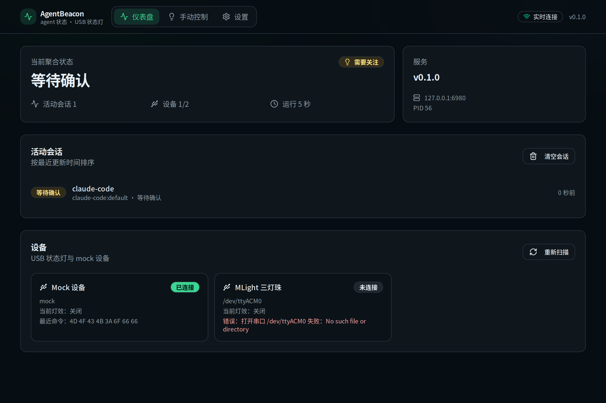

<p align="center">
  
</p>

<h1 align="center">AgentBeacon</h1>

<p align="center">
  把编码 agent 的状态同步到 USB 状态灯。
</p>

<p align="center">
  <a href="https://github.com/zeaphoo/AgentBeacon/actions/workflows/ci.yml"></a>
  <a href="https://github.com/zeaphoo/AgentBeacon/actions/workflows/release.yml"></a>
  <a href="LICENSE"></a>
  <a href="README.md">English</a>
</p>



AgentBeacon 在本地运行，监听编码 agent 上报的状态，并把它转换成直观的灯光信号。项目包含 Rust 常驻服务、React Web 控制台和 Tauri 桌面应用。

## 特性

- **实时 agent 状态** — 将 `idle`、`working`、`waiting`、`error` 会话聚合为一个语义状态。
- **USB 状态灯** — 支持 MLight 单灯珠/三灯珠和 YH50-RGY-J，支持热插拔发现与按设备覆盖型号。
- **设备能力** — 按设备和型号展示是否支持亮度调节、蜂鸣器等特性。
- **Web 控制台** — 状态总览、手动灯光控制、设置自动保存、灯具页的设备绑定与支持型号列表。
- **桌面应用** — 启动页、托盘菜单、开机自启动和本地服务托管，覆盖 Linux、macOS 与 Windows。
- **Agent 集成** — 为 Pi、OpenCode、DeepSeek Harness、Claude Code、Codex CLI、Qoder CLI 以及 Gemini CLI 家族（Gemini / Qwen Code / iFlow）提供安装器管理的 hook 与插件；其他 agent 可通过 CLI 或 HTTP 接入。
- **无硬件测试** — 可选 mock 设备验证「上报 → 聚合 → 设备命令」完整链路。
- **Hook 诊断日志** — 保留最近的 hook 事件与状态迁移，可用 `agent-beacon hooks` 或 `GET /api/v1/hooks` 查看。
- **中英文与主题** — 中文/English、浅色/深色主题、按系统语言初始化、主题可跟随系统。
- **本地优先** — 服务默认监听 `127.0.0.1:6980`，不需要云端账号，不上报遥测。

## 支持的设备

| 型号 | 连接方式 | 亮度调节 | 蜂鸣器 | 说明 |
| --- | --- | :---: | :---: | --- |
| `mlight-single` | USB CDC | ✅ | — | 单灯珠 RGB 状态灯 |
| `mlight-3led` | USB CDC | ✅ | — | 三灯珠 RGB 状态灯 |
| `yh50-rgy-j` | USB 串口 / libusb | — | ✅ | 三色 LED + 蜂鸣器 |
| `mock` | 虚拟设备 | — | — | 开发与无硬件验证 |

Web 控制台会在每个已连接设备上显示对应的能力徽章。

## 界面

主界面包含四个区域：

- **状态** — 当前聚合状态、活动会话、已连接设备和实时服务运行时长。
- **灯具** — 临时覆盖自动灯效（灯效、时长、作用设备）、设备列表与按设备覆盖型号绑定，支持型号列表通过按钮在可滚动对话框中查看。
- **设置** — 状态映射、灯光行为（默认覆盖时长、亮度、退出关灯、告警蜂鸣）和本地服务信息。
- **Agent 集成** — 所有检测到的 agent 及其安装状态，支持一键安装/升级/卸载与「自动安装」开关。

导航栏可直接切换语言和主题。当前聚合状态卡片使用状态色作为低饱和背景，并用更大的图标和文字突出当前状态。

## 快速开始

1. 从 [Releases](https://github.com/zeaphoo/AgentBeacon/releases) 下载对应平台的安装包：
   - Linux：`.deb` 或 `.AppImage`
   - macOS：arm64 / x86_64 `.dmg`
   - Windows：NSIS 安装包、MSI 或便携 `.zip`
2. 启动 **AgentBeacon**（或运行 `agent-beacon` 后打开 `http://127.0.0.1:6980`）。
3. 插入 MLight 或 YH50-RGY-J 状态灯，设备会自动发现。
4. 安装 agent 集成：

   ```bash
   agent-beacon integrate install pi           # Pi
   agent-beacon integrate install opencode     # OpenCode
   agent-beacon integrate install dsh          # DeepSeek Harness
   agent-beacon integrate install claude-code  # Claude Code
   agent-beacon integrate install codex        # Codex CLI
   agent-beacon integrate install gemini       # Gemini CLI（qwen、iflow 同理）
   agent-beacon integrate install qoder        # Qoder CLI
   agent-beacon integrate install codebuddy    # CodeBuddy（同理 workbuddy）
   agent-beacon integrate install github-copilot  # GitHub Copilot
   agent-beacon integrate install hermes       # Hermes Agent
   agent-beacon integrate install zcode        # ZCode
   ```

   `agent-beacon integrate install` 不带目标时会安装所有检测到的 agent；`agent-beacon integrate list` 可查看已安装、内置与可用状态。

   也可以在控制台完成：**Agent 集成**页面会列出所有检测到的 agent 及其安装状态，支持一键安装/升级/卸载，以及「自动安装」开关；首次启动时控制台会提示接入检测到的 agent。

5. 打开控制台查看状态、试用灯光控制或调整设置。

从源码构建、打包、测试和架构说明见[开发文档](docs/development.zh-CN.md)。

## Agent 集成

| Agent | 接入方式 | 文档 |
| --- | --- | --- |
| Pi | Extension | [Pi](docs/integrations/pi.md) |
| OpenCode | Plugin | [OpenCode](docs/integrations/opencode.md) |
| DeepSeek Harness | Cordis plugin | [DeepSeek Harness](docs/integrations/dsh.md) |
| Claude Code | `settings.json` hooks | [Claude Code](docs/integrations/claude-code.md) |
| Qoder CLI | `settings.json` hooks | [Qoder CLI](docs/integrations/qoder.md) |
| Gemini CLI · Qwen Code · iFlow | `settings.json` hooks | [Gemini 家族](docs/integrations/gemini.md) |
| CodeBuddy | `settings.json` hooks（Claude 式） | [CodeBuddy](docs/integrations/codebuddy.md) |
| WorkBuddy | `settings.json` hooks（CodeBuddy 运行时） | [WorkBuddy](docs/integrations/workbuddy.md) |
| GitHub Copilot | `settings.json` hooks（camelCase 事件） | [GitHub Copilot](docs/integrations/github-copilot.md) |
| ZCode | `config.json` process hooks | [ZCode](docs/integrations/zcode.md) |
| Hermes Agent | 插件目录（`plugin.yaml` + python） | [Hermes Agent](docs/integrations/hermes.md) |
| Codex CLI | `config.toml` `notify` | [Codex CLI](docs/integrations/codex.md) |
| 其他 agent | `agent-beacon report` 或 `POST /api/v1/events` | [开发文档 HTTP API](docs/development.zh-CN.md#http-api) |

内置集成随服务分发，可通过 CLI 安装或升级。

## 文档

- [开发文档](docs/development.zh-CN.md) — 架构、环境准备、构建、测试、发布与贡献
- [English documentation](README.md)
- [更新日志](CHANGELOG.zh-CN.md) · [English changelog](CHANGELOG.md)
- [MLight 协议](docs/MLight-serial-protocol.md)
- [YH50-RGY-J 协议](docs/YH50-RGY-J-serial-protocol.md)
- [AgentCore-Light 协议](docs/AgentCore-Light-serial-protocol.md)
- [硬件验收清单](docs/hardware-checklist.md)

## 项目状态

当前为预发布版本（`0.1.0-rc.1`）。稳定版发布前，API、配置字段和打包方式可能继续调整。

## 许可证

本项目使用 [Apache License 2.0](LICENSE) 许可。
