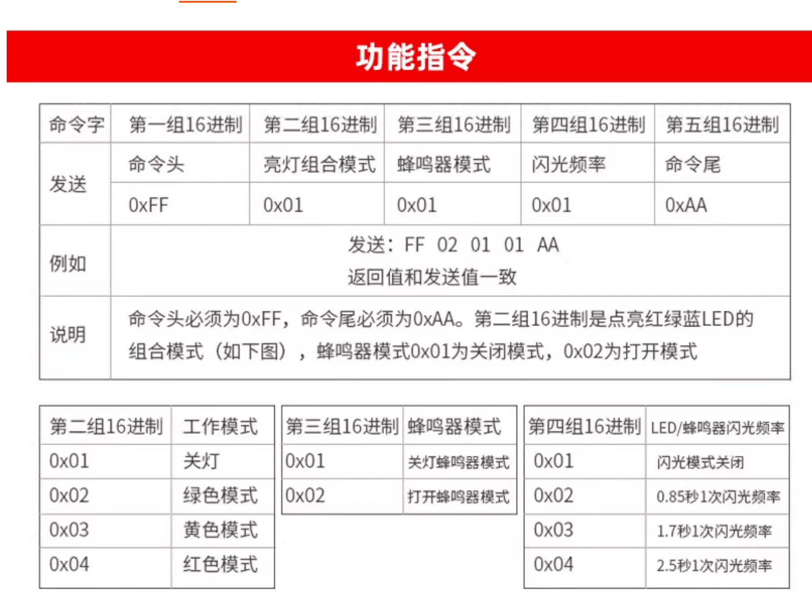

# 源煌 YH50-RGY-J 报警灯（CH340 串口）控制协议

> 设备：**源煌电气科技** 三色声光报警灯，型号 **YH50-RGY-J**
> 依据：厂商《功能指令》说明（随附协议图）＋ 主机侧实现核对

- 文档版本：v1.2（聚焦本设备协议，移除与其他灯型的对比）
- 整理日期：2026-11-03

---

## 目录

1. [概览](#1-概览)
2. [帧格式](#2-帧格式)
3. [字段定义](#3-字段定义)
4. [示例](#4-示例)
5. [设备回显](#5-设备回显)
6. [主机侧实现参考](#6-主机侧实现参考)
7. [预设灯效](#7-预设灯效)
8. [手动测试](#8-手动测试)
9. [待验证项](#9-待验证项)

---

## 1. 概览

| 项目 | 值 |
| --- | --- |
| 厂商 | 源煌电气科技 |
| 型号 | **YH50-RGY-J** |
| 设备类型 | 三色 LED（红/绿/黄）+ 有源蜂鸣器 |
| 通信芯片 | CH340/CH341 USB 转串口 |
| USB VID | `0x1A86`（沁恒 WCH） |
| USB PID | `0x7523`（CH340） |
| 波特率 | **9600** |
| 帧格式 | 8 数据位 / 无校验 / 1 停止位（8N1）/ 无流控 |
| 帧长度 | **固定 5 字节** |
| 校验 | **无**（无校验和、无长度字段） |
| 通信方向 | 主机写；设备回显（见 §5），主机侧不解析 |
| 端口名 | Linux `/dev/ttyUSB0`（CH340 驱动），Windows `COMx` |

> 型号中的 `RGY` 对应红、绿、黄三色，`J` 表示带蜂鸣器（按命名推断，需以厂商规格书为准）。

---

## 2. 帧格式

```
┌──────┬────────────┬────────────┬────────────┬──────┐
│ 0xFF │ LED 模式   │ 蜂鸣器模式 │ 闪光频率   │ 0xAA │
│ 命令头│ 1 字节     │ 1 字节     │ 1 字节     │ 命令尾│
└──────┴────────────┴────────────┴────────────┴──────┘
```



- 命令头固定 `0xFF`，命令尾固定 `0xAA`，**必须**存在。
- 中间三个字段都是 **1 起始**的枚举（不是 0 起始），取值不连续时按表查。
- 没有任何转义机制；因为字段值不会等于 `0xFF/0xAA`，所以无需转义。

---

## 3. 字段定义

### 3.1 字节 1：亮灯组合模式

| 值 | 工作模式 | 说明 |
| --- | --- | --- |
| `0x01` | 关灯 | 关闭 LED |
| `0x02` | 绿色模式 | |
| `0x03` | 黄色模式 | |
| `0x04` | 红色模式 | |

### 3.2 字节 2：蜂鸣器模式

| 值 | 状态 |
| --- | --- |
| `0x01` | 关闭 |
| `0x02` | 打开 |

> 蜂鸣器与 LED 相互独立：可以只响不亮、只亮不响，也可以同时。

### 3.3 字节 3：闪光频率

| 值 | 频率 | 说明 |
| --- | --- | --- |
| `0x01` | 闪光模式关闭 | 常亮/常灭，不闪 |
| `0x02` | 0.85 秒 1 次 | 快 |
| `0x03` | 1.7 秒 1 次 | 中 |
| `0x04` | 2.5 秒 1 次 | 慢 |

> 厂商表格的列名为「LED/蜂鸣器闪光频率」，即该字段可能同时控制 LED 与蜂鸣器的闪烁节奏
> （待真机确认，见 §10）。

---

## 4. 示例

| 意图 | 帧（十六进制） |
| --- | --- |
| 全关 | `FF 01 01 01 AA` |
| 绿灯常亮 | `FF 02 01 01 AA` ← 厂商示例 |
| 黄灯常亮 | `FF 03 01 01 AA` |
| 红灯常亮 | `FF 04 01 01 AA` |
| 红灯 0.85s 闪烁 | `FF 04 01 02 AA` |
| 红灯常亮 + 蜂鸣 | `FF 04 02 01 AA` |
| 红灯闪烁 + 蜂鸣 | `FF 04 02 02 AA` |

厂商示例原文：

```
发送：FF 02 01 01 AA
返回值与发送值一致
```

---

## 5. 设备回显

厂商说明注明 **"返回值和发送值一致"** —— 设备会把收到的 5 字节原样回显。

但主机侧实现**没有读取和校验回显**（只写不读），因此：

- 写成功 ≠ 命令被执行；串口打开失败或设备未响应时，主机只能靠 `write` 的返回值判断。
- 若要做可靠控制，可读取 5 字节回显做比对（需处理超时与积压数据）。

---

## 6. 主机侧实现参考

| 维度 | 桌面端（Rust/Tauri） | 原生模块端（Electron + Neon） |
| --- | --- | --- |
| 端口选择 | 遍历串口，匹配 VID/PID | 同左；**兜底**：若只有一个 `ttyUSB*`/`ttyACM*` 就直接用 |
| Windows | 仅串口 | 仅串口 |
| Linux / macOS | 先尝试 **libusb 直接 Bulk 传输**（claim interface 0，找第一个 OUT 端点），失败后回退串口 | 仅串口 |
| 打开时序 | 直接 `write_all` + `flush` | 置位 **DTR 和 RTS**，延时 **50 ms** 再写，然后 `flush` |
| 超时 | 读写 1000 ms | 1000 ms |
| 串口参数 | 9600 8N1 无流控 | 9600 8N1 无流控 |

> 关键点：帧内含 `0xFF`/`0xAA` 裸字节，**不能用文本模式写串口**（不能按字符串发送）。
> 主机侧不区分"关灯"和"关蜂鸣"，所有控制都靠这一帧的三个字段组合。

---

## 7. 预设灯效

常见上位机内置的预设及其对应帧：

| 预设 | LED | 蜂鸣器 | 频率 | 帧 |
| --- | --- | --- | --- | --- |
| `green` | 绿 | 关 | 关闭 | `FF 02 01 01 AA` |
| `green_flash` | 绿 | 关 | 中（1.7s） | `FF 02 01 03 AA` |
| `yellow` | 黄 | 关 | 关闭 | `FF 03 01 01 AA` |
| `yellow_flash` | 黄 | 关 | 中（1.7s） | `FF 03 01 03 AA` |
| `red` | 红 | 关 | 关闭 | `FF 04 01 01 AA` |
| `red_flash` | 红 | 关 | 中（1.7s） | `FF 04 01 03 AA` |
| `red_buzzer` | 红 | 开 | 中（1.7s） | `FF 04 02 03 AA` |
| `yellow_buzzer` | 黄 | 开 | 中（1.7s） | `FF 03 02 03 AA` |
| `buzzer` | 红 | 开 | 中（1.7s） | `FF 04 02 03 AA` |
| 全关 / `turn_off` | 关 | 关 | 关闭 | `FF 01 01 01 AA` |

> 不同实现里 `*_flash` 选用的档位并不统一：桌面端用 medium（1.7s，`0x03`），
> 另一套 UI 用 fast（0.85s，`0x02`）。跨端一致时需要先约定。

---

## 8. 手动测试

### 8.1 Linux（CH340 一般为 `/dev/ttyUSB0`）

```bash
PORT=/dev/ttyUSB0
stty -F "$PORT" 9600 cs8 -cstopb -parenb -echo raw

# 绿灯常亮
printf '\xFF\x02\x01\x01\xAA' > "$PORT"

# 红灯 0.85s 闪烁 + 蜂鸣
printf '\xFF\x04\x02\x02\xAA' > "$PORT"

# 全关
printf '\xFF\x01\x01\x01\xAA' > "$PORT"
```

> `printf` 需支持 `\xHH`（bash 内建支持）。不要用 `echo -e`，行为不一致。

### 8.2 Python（pyserial）

```python
import serial

FRAME = lambda led, buz, freq: bytes([0xFF, led, buz, freq, 0xAA])

ser = serial.Serial('/dev/ttyUSB0', 9600, timeout=1)  # Windows: 'COM5'
ser.dtr = True
ser.rts = True

ser.write(FRAME(0x02, 0x01, 0x01))   # 绿灯常亮
ser.write(FRAME(0x04, 0x02, 0x02))   # 红灯快闪 + 蜂鸣
ser.write(FRAME(0x01, 0x01, 0x01))   # 全关
ser.close()
```

### 8.3 最小可用帧构造

```c
uint8_t frame[5] = {0xFF, led_mode, buzzer_mode, flash_freq, 0xAA};
write(fd, frame, 5);
```

---

## 9. 待验证项

| 项 | 验证方法 |
| --- | --- |
| 闪光频率是否同时作用于蜂鸣器 | 发 `FF 04 02 02 AA`，听蜂鸣器是否间歇 |
| 回显内容与时机 | 打开串口后发一帧，读取 5 字节比对；观察是否有启动噪声 |
| 设备上电默认状态 | 上电后不发送任何帧，观察灯与蜂鸣器状态 |
| 未知字段值的容错 | 发 `FF 05 01 01 AA`，观察是否忽略/异常 |
| 连续发帧的最小间隔 | 50 ms 间隔连发多帧，观察是否丢帧 |
| CH340 在 Linux 的驱动占用 | libusb 直连与 ch341 内核驱动是否冲突（影响 §6 的回退逻辑） |

---

## 附录 A：证据来源

| 结论 | 证据 |
| --- | --- |
| 厂商与型号 | 厂商资料：源煌电气科技 YH50-RGY-J |
| 帧结构、字段取值、回显 | 厂商《功能指令》说明图（随附协议截图） |
| VID/PID、9600 8N1 | 主机侧实现核对 |
| libusb 直连与串口回退 | 主机侧实现核对 |
| DTR/RTS + 50 ms | 主机侧实现核对 |
| 预设映射 | 主机侧实现核对 |
