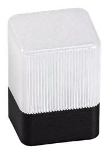
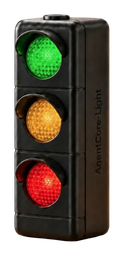
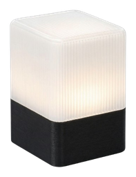

# 硬件购买链接

这里收录维护者自购并验收过的同款状态灯，方便想上真机的用户直接下单。本项目不经销硬件，
商品页、价格、库存与规格由第三方卖家维护，可能随时下架或改版；下单前请自行确认型号、接口
和规格选项。

| 型号 | profile | 连接方式 | 推荐 | 购买 |
| --- | --- | --- | :---: | --- |
| MLight | `mlight-3led` | USB CDC | ✅ | [淘宝 · 鹿城笑笑生数码](https://item.taobao.com/item.htm?id=1086328824173&skuId=6321112478105) |
| AgentCore-Light | `agentcore-light` | USB CDC / 蓝牙 SPP / BLE(NUS) | — | [淘宝 · BuildFPGA](https://item.taobao.com/item.htm?id=1059050729014&skuId=6102524545314) |
| AgentCore-Halo | `agentcore-halo` | USB CDC / 蓝牙 SPP / BLE(NUS) | ✅ | [淘宝 · BuildFPGA](https://item.taobao.com/item.htm?id=1095793862793&skuId=6317726979193) |

## MLight

- **profile** —— 商品对应三灯珠 `mlight-3led`；`mlight-single` 是同协议的单灯珠技术 profile，
  没有独立商品与配图。
- **外观** —— 白色罗纹立方 + 黑色底座；与 AgentCore-Halo 同款但尺寸更小。配图为三灯珠实拍
  图，单灯珠暂无独立配图（控制台回落通用 USB 图标）。
- **连接** —— USB CDC，VID:PID `2E8A:0003` / `000A`，插入后自动发现，无需驱动。
- **购买** —— [淘宝 · 鹿城笑笑生数码](https://item.taobao.com/item.htm?id=1086328824173&skuId=6321112478105)
- **协议** —— 见 [MLight 串口协议](MLight-serial-protocol.md)。

## AgentCore-Light

- **profile** —— `agentcore-light`；支持 Logo / 团队标识定制，灯效与蜂鸣保留。
- **连接** —— USB CDC / 蓝牙 SPP / BLE(NUS)；按 VID `4C4A:4155`、Espressif `303A` +
  产品名、SPP 端口 + `HELLO` 握手，或带 NUS service 的 BLE 广播识别。
- **购买** —— [淘宝 · BuildFPGA](https://item.taobao.com/item.htm?id=1059050729014&skuId=6102524545314)
- **协议** —— 见 [AgentCore-Light 串口协议](AgentCore-Light-serial-protocol.md)。

## AgentCore-Halo

- **profile** —— `agentcore-halo`；与 `agentcore-light` 共用文本行协议。
- **外观** —— 与 MLight 同款：白色罗纹立方 + 黑色底座，但整体尺寸更大（灯体更高、底座更宽）。
- **连接** —— USB CDC / 蓝牙 SPP / BLE(NUS)；按设备名 `AgentCore-Halo` / `AgentCore-Halo-BLE`
  识别，控制台显示固件版本与电量。
- **购买** —— [淘宝 · BuildFPGA](https://item.taobao.com/item.htm?id=1095793862793&skuId=6317726979193)
- **协议** —— 见 [AgentCore-Halo 串口协议](AgentCore-Halo-serial-protocol.md)。
